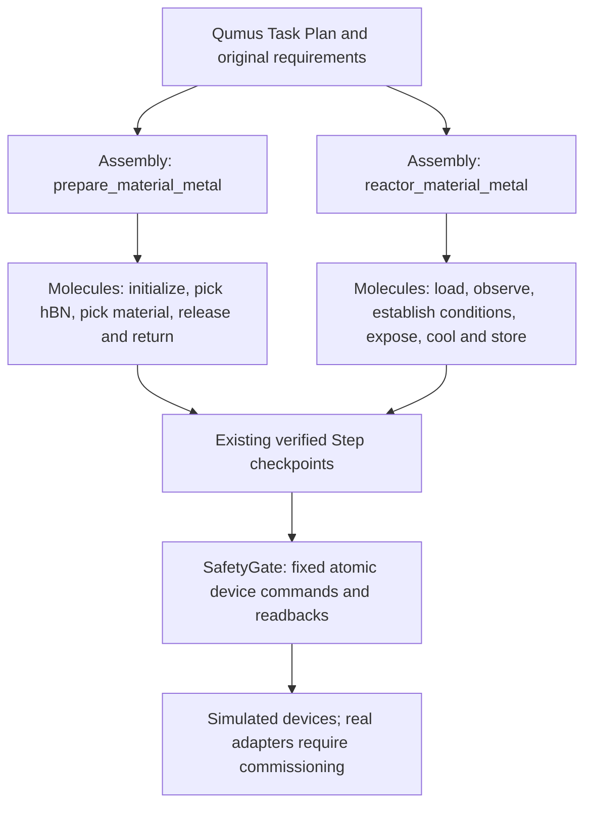

# vdW workflow hierarchy: owner review

Reviewed 27–28 October 2026 (America/New_York). This document describes executable
code and its limitations, rather than a proposed physical reaction recipe.

## Audit conclusion

The earlier implementation had fixed guarded device interfaces, independently
verified Steps, typed task parameters, reservations, role handoffs and checked
results. However, its vdW assembly jobs were predominantly flat Step lists.
There was no explicit reusable molecular composition or persisted mapping from
an assembly to its molecular operations. Calling that a complete implementation
of the v1 hierarchy would have overstated it.

The repair adds `Molecule` and `Assembly` compositions in
`qumus2/flows/workflow.py`. The normal material-metal preparation, input
assessment and reaction now build their actual executable Steps from those
compositions. Ordinary dry-transfer stacking supplies the preparation's middle
operations. Standalone reactor loading, unloading, observation and terminal
readback reuse the same reactor definitions. No second scheduler is introduced.

The reference is the frozen v1 source: `AssemblyDevice` in
`v1compare/v1/agents/processing_agent/workflows/stacking/assembly_flows/assembly_device.py`
composes operations such as `MoleculePickUp`, which calls fixed atom wrappers.
The local paper reading notes identify the same fixed-atom, composable-molecule,
composable-assembly principle (Fig. 1, Methods and Extended Data Table 1).
The frozen source and manifest remain unchanged. The paper reading notes are at
`../notes/v1/paper-qumus-2026/qumus-paper-reading-notes.md` relative to the repository.

This implements that extension pattern with reviewed Python compositions.
The running model selects registered operations and bounded parameters; it does
not generate, execute or automatically publish arbitrary new Python workflows.
Autonomous workflow synthesis and promotion to a reusable skill are not added
or claimed. The Qumus Task Plan remains the higher project-level plan that
delegates these jobs, rather than a replacement for the hardware hierarchy.

## Atomic level: fixed device capabilities

An atomic operation commands or reads one device capability. It does not decide
how to perform a whole experiment. Existing upstream controllers own wire
protocols, while the fixed Qumus device interfaces normalize units and enforce
SafetyGate limits. The table lists capabilities used by this extension, rather
than claiming every upstream feature is connected.

| Source | Atomic capabilities used or represented | Qumus boundary | Current implementation status |
| --- | --- | --- | --- |
| dobot_mg400, pointing to the MG400 interface | Arm motion and pose/status feedback; controller ownership and command acknowledgement | `Arm.move_to`, `get_pose`, held-object control behind `SafetyGate.arm` | Simulated reactor arm. A commissioned MG400 arm/end-effector adapter is still missing. `Arm.set_vacuum` cannot stand in for an unverified mechanical gripper. |
| Stage-Motor-Controller | Select bottom/top/insert motor, finite pulse move, stop and read status | `reactor_slot.move_to/get_pose` for whole-assembly XY; `reactor_insert.move_to/get_pose` for the rod | Simulation plus injected `ReactorMotorBank` / `ControllerReactorStage` foundation. Real pulse/mm, signs, reference and independent position feedback are required. Pulse counters alone are not measured absolute position. |
| Objective-Control | Objective selection, focus motion, camera capture and calibration observations | `Microscope.set_objective`, `set_focus`, `get_focus`, `capture` | Simulated reactor microscope. The reviewed source contains differing firmware protocols; matching real protocol, objective identification and motion completion are not yet bound. |
| FurnaceCode | Apply/stop temperature setpoint, read actual temperature; set/stop gas flow and inspect measured flow | `Heater.set_target/off/read_temperature/get_target`; `GasFlowController.set_flow/read_flow/get_target` | Simulation plus injected `FurnaceServiceHeater` and `FurnaceServiceGasFlow`. Per-gas full scale converts percent to sccm, and feedback freshness is checked. |

Atomic readbacks and command acknowledgements are distinct: requesting 300 C
does not establish a measured 300 C, and a zero target does not establish zero
residual flow. No atomic API, serial protocol or safety envelope was rewritten
for this hierarchy repair. New high-level names are not new hardware commands.

The source evidence is the local read-only snapshots under
`../notes/reactor-integration-20261026/sources/`, pinned by the earlier review:

| Repository | Reviewed revision |
| --- | --- |
| [dobot_mg400](https://github.com/WuLabPrinceton/dobot_mg400) | `e6313a17f14cbb828fde848392cddfd6fab72d91`, which points to the MG400 implementation |
| [MG400 implementation](https://github.com/shc0507/dobot_mg400) | `92d3e2d2072901765a3b362fe89938223c719075`; snapshot includes protocol, feedback, ownership and configuration code |
| [Stage-Motor-Controller](https://github.com/WuLabPrinceton/Stage-Motor-Controller) | `8dda99679b46934f83de0c0d8b4f96f5f66567f7` |
| [Objective-Control](https://github.com/WuLabPrinceton/Objective-Control) | `3a2dad07960fa08f2ae0e551ad426e0ce48cd482` |
| [FurnaceCode](https://github.com/WuLabPrinceton/FurnaceCode) | `ebbf84b0badb55be43539c7d4b438c20615766c2` |

This chat could not refresh those repositories: the connected GitHub reader
returned 404 for all four user links, and web reads also failed. These are
source-snapshot findings, not claims about the latest upstream branches.
See `reactor-hardware.md` for the detailed adapter and commissioning boundary.

## Molecular level: one meaningful laboratory operation

A molecular operation combines fixed atomic calls with observation, bounded
correction and postcondition checks. Its Steps are recovery checkpoints.
A Step can contain several atomic calls or a bounded focus/feedback loop;
**Step is not a synonym for atom**. Computation-only contract checks also occur
at this level, without inventing a physical operation.

| Operation identity | Plain description | Inputs and checked outcome |
| --- | --- | --- |
| `cool_transfer_stage` | Cool the ordinary transfer stage before candidate inspection | Existing stage and measured temperature; no flake is transferred. |
| `assess_source_<chip>` | Bring one source chip under ordinary optics, refind candidates, inspect their pickup neighbourhoods and put it back | Screened photographed flake IDs and source chip; saved local isolation evidence. A crowded flake can be recorded as rejected even when the inspection job itself succeeds. |
| `admit_and_handover` | Check the original preparation contract and pass the metal-coated carrier to shared transfer storage | Current requirement, carrier and support identity; guarded Arm3 handover. |
| `initialize_transfer` | Establish the transfer temperature and load the known stamp | A fresh known PC/mica stamp and resolved simulated transfer profile; checked stage/stamp state. |
| `pickup_layer_<flake>` | Load and refind a source, recheck its neighbourhood, align the stamp, pick up that layer and return the source chip | Exact confirmed flake ID and material; verified pickup. First hBN, then the reactive material. The existing bounded torn-stamp recovery remains inside this operation. |
| `release_stack` | Bring in the target, align and release the stack, verify its image, cool and store the target | Exact metal/Si carrier, ordered flakes, known support and configured profile; a saved release micrograph and preparation receipt. Failed release cannot produce a valid preparation. |
| `return_stamp` | Return the used stamp to its reserved storage slot | Current stamp and reserved slot; checked return. Support retention follows the explicitly uncalibrated PC/mica simulation profile. |
| `return_prepared_carrier` | Pass the prepared carrier back to dedicated reactor storage | Prepared carrier and original reactor slot; checked Arm3 transport. |
| `check_contract` | Recheck the frozen requirements, preparation and reaction goal before starting | Original requirement event and receipt; no replacement of material, metal, support or goal. |
| `load_and_acquire` | Seat the carrier, insert the rod, focus and search within bounded XY offsets until both full input outlines are visible | Stored carrier, reserved slot and configured insertion distance; measured seating and optical acquisition. Whole-assembly XY and rod insertion remain separate motions. |
| `observe_before_exposure` / `observe_carrier` | Save an observation of the loaded carrier, optionally refocusing for a standalone observation | Carrier identity and current image; saving another image does not independently advance the material model. |
| `establish_conditions` | Set temperature/flow and wait for measured feedback to settle | Bounded recipe parameters and loaded visible carrier; actual temperature and flow within tolerance. Interrupted establishment is unsafe to replay automatically. |
| `observe_exposure` | Run one bounded treatment window and save observations at intervals | Duration and observation interval; observed qualitative progress. Process execution is separate from reaching the requested target. |
| `shutdown_and_cool` | Disable both targets and wait for measured access conditions | Actual heater/gas feedback; residual heat and flow must fall below the configured simulation access thresholds. |
| `observe_after_cooling` | Save another image after measured cooling, before returning or holding the carrier | Same carrier and original layers; observation evidence. |
| `store_carrier` | Reset assembly XY, retract the rod and return the carrier to its reserved storage slot | Cold carrier and known home slot; guarded return. This operation is omitted for an explicit cooled observation hold. |
| `record_terminal` | Read the final carrier location, temperatures, flow, targets and insertion position | For cold storage: stored carrier, targets off, measured access conditions and rod retracted. Readback cannot certify that an interrupted exposure finished. |

Preparation reuses the dry-transfer molecules rather than implementing a second
pickup algorithm. Device-specific replacements enforce the material-metal
contract, inspect pickup isolation and use the appropriate simulated release
profile. The actual fixed device calls remain below SafetyGate.

## Assembly level: a complete checked job

| Registered operation | Molecular composition | Responsible agent and completion meaning |
| --- | --- | --- |
| `assess_reactor_inputs` | Cool transfer stage -> assess each source -> record terminal conditions | Hands measures candidates previously screened by Picker; Picker subsequently confirms the exact pair. Inspection completion does not mean every candidate passed. |
| `prepare_material_metal` | Admit/handover -> initialize transfer -> pick hBN -> pick reactive material -> release/verify -> return stamp -> return prepared carrier -> record terminal conditions | Hands creates the simulated prepared carrier. The final top-to-bottom order is hBN / specified reactive material / specified metal / silicon. hBN remains nonreactive. |
| `reactor_material_metal` | Check contract -> load/acquire -> observe -> establish conditions -> observe exposure -> shutdown/cool -> observe -> store if required -> record terminal conditions | Reactor performs the simulated process under the Qumus-bound objective. Successful execution alone does not mean the target passed. |
| `load_reactor_chip` | Load/acquire -> record terminal conditions | Reactor loads a carrier for an explicit standalone/compatibility task. Do not pre-load before the full `reactor_material_metal` job. |
| `unload_reactor_chip` | Shutdown/cool -> store carrier -> record terminal conditions | Reactor recovers a loaded carrier under its existing guarded conditions. |

`observe_reactor` and `verify_reactor_state` are standalone molecular jobs.
The latter verifies a carrier already in cold storage; it does not move it or
change targets. Historical two-reactant, field-growth, abstract-receipt and
product-reinspection flows retain their existing compatibility implementations;
they are not relabelled as the current material-metal experiment.

At project level, Qumus captures the human requirements, consults Advisor and
Eyes, asks Picker to screen, delegates local inspection to Hands, asks Picker
to confirm, delegates preparation to Hands and processing to Reactor, then checks
the result. `submit_material_metal_result` is a separate evidence acceptance
operation. It is not a physical treatment or an atomic device capability.

## Execution, persistence and recovery contract

- `Flow.build_workflow(params)` optionally supplies an executable `Assembly` or
  `Molecule`. Flattening returns the existing Steps in their original order.
  `build_steps` remains the execution/recovery interface. Existing unconverted
  flows return no hierarchy.
- Molecular identities are unique within an assembly; duplicate mutable Step
  instances are refused. Each molecular operation owns a contiguous range of
  original zero-based checkpoint sequence numbers.
- New jobs save their hierarchy in existing `run.meta.workflow` and append
  `job.workflow` with `reason=submitted`. A checked in-flow replan saves the new
  hierarchy and appends `reason=replanned`; the previous event remains evidence.
- `wait_job` and `get_job_status` expose `workflow`. Routine replies show names,
  levels and sequence ranges. `get_job_status(full=true)` includes descriptions
  and checkpoint names/resume flags. Local and lab-process status paths read
  the same persisted metadata. No original hierarchy is guessed for old jobs.
- This metadata is an execution plan, not a completion flag. Actual checkpoint
  statuses, observations, job status, sample state and result checks establish
  progress and acceptance. An assembly label cannot certify completion.
- The scheduler, resource locks, reservations, SafetyGate, StepRunner and Clock
  remain the execution path. Pause, retry, reverify and restart continue from
  the original unfinished checkpoint, never from a molecule's beginning.
- Temperature establishment, exposure and hot release keep their existing
  unsafe-resume flags and evidence-based recovery restrictions. Failed optical
  checks disable targets and park; a new image cannot reconstruct interrupted
  thermal history. The failed observation and uncertainty remain visible.

## Remaining limitations

The normal path remains qualitative device simulation. Its success may satisfy
the simulated task, while `experiment_accepted`, `chemistry_verified` and
`physical_motion_verified` remain false. It does not prove Gr/Pd chemistry,
release reliability, a named product, yield or electrical performance.

The present recipe controls one configured gas channel. FurnaceCode also has
valve/channel and water-flow capabilities that are not assembled into a reviewed
multi-gas or cooling-water process here. No purge, gas-switching or pressure
protocol is invented. Those need an explicit experimental protocol and device
contract before extending the molecular layer. Similarly, real MG400 gripping
and Objective-Control completion/calibration need adapters before this hierarchy
can be commissioned on the apparatus.

The implementation audit fixes the missing explicit hierarchy and traceability.
It does not establish that the earlier development followed every historical
v1 development step; source and final behavior are what can be checked here.

## Validation

The final vdW code and tests are frozen for integration handoff. No live model
calls, hardware operations, Actions, commit or push were performed.

| Check | Command / evidence | Result |
| --- | --- | --- |
| Final relevant regression | `.venv/bin/python -m pytest tests/test_workflow_hierarchy.py tests/test_material_metal_devices.py tests/test_material_metal_workflow.py tests/test_reactor_preparation.py tests/test_reactor_workflow.py tests/test_stacking.py tests/test_recovery.py -o addopts='' -q -p no:cacheprovider` | **107 passed in 81.00 s**, after the final wrapper simplification. |
| Shared-checkout broad regression | `.venv/bin/python -m pytest -o addopts='' -q -p no:cacheprovider` | **1,229 passed, 8 skipped in 501.32 s**. Context/UI/billing work was concurrent, so this is regression evidence, not the final frozen-source release acceptance. The coordinator will run that once all workstreams freeze. |
| Node-dependent offline event consumers | Add bundled `dependencies/node/bin` to PATH; run `test_ui_event_logic.py`, `test_material_metal_ui.py`, `test_job_reference_ui_evidence`, and `test_material_assessment_and_area_survive_database_and_actual_ui_event_replay` | **6 passed in 1.28 s**, covering the six skips caused by the default shell lacking Node. |
| Isolated frozen-v1 compatibility | `.venv-v1compare/bin/python -m pytest tests/test_v1compare.py -o addopts='' -q -p no:cacheprovider` | **14 passed in 7.29 s**, including the two dependency cases skipped in the modern environment and the byte-identical source manifest. |
| Static / whitespace | `.venv/bin/python -m ruff check --no-cache .`; `git diff --check` | Both passed. |
| Before/after builder comparison | Compare types, names, parameters and unsafe-resume flags against the pre-change Git builders, without calling devices | All **13 variants** matched: ordinary/swapped stacking and preparation; cold-storage/hold reaction; load/unload; observation with/without autofocus; terminal readback; input assessment; legacy pair preparation. |

The guarded device tests include ordinary exfoliation/search/assessment/transfer
before preparation, PC and mica, failed release, insufficient progress, camera
loss, requirement/goal tampering and successful database/world restoration.
New tests interrupt an actual simulated exposure and interrupt hot release after
its physical act but before verification. Resume/restart parks at the same
unsafe checkpoint, with targets off and reservations retained; neither molecular
operation is replayed. Completed jobs retain the exact hierarchy after restart.
Reservation-failure tests verify that job, hierarchy, events and reservations
roll back together. Existing stamp-swap/crash/Stop tests continue to pass.

The final ordered code/test scope SHA-256 is
`6d8959fb7343ad1ebc65b81ae6479484a28a7c3735b7a4e960b17be8cc5329f3`.
The private handoff receipt is `runs/checks/vdw-hierarchy-handoff.json`.

## Exact changed files and integration handoff

| Area | Files |
| --- | --- |
| Composition contract | `qumus2/flows/workflow.py` (new), `qumus2/flows/flow.py` |
| Reused dry transfer | `qumus2/flows/library/stacking.py` |
| vdW compositions | `qumus2/flows/library/reactor.py`, `qumus2/flows/library/reactor_preparation.py`, `qumus2/flows/library/material_metal.py`, `qumus2/flows/library/material_metal_device.py` |
| Persistence and job queries | `qumus2/runtime/jobs.py`, `qumus2/runtime/remote.py`, `qumus2/agents/tools/hardware.py` |
| Reactor guidance | `qumus2/agents/prompts/reactor.md` |
| Tests | `tests/test_workflow_hierarchy.py` (new), `tests/test_material_metal_devices.py` |
| Documentation | `docs/vdw-workflow-hierarchy.md` (new), minimal additive sections in `docs/architecture.md` and `docs/workstreams.md` |

Five hierarchy-only `build_steps` wrappers were removed: these classes now use
`Flow.build_steps` directly. `StackDeviceFlow.stack_workflow` and its independent
`build_steps` remain necessary for the old pair subclass, which adds its own
flat transport/verification steps. Its `build_workflow` explicitly returns None,
so it cannot accidentally inherit an incomplete modern hierarchy. The abstract
material-metal fixture also retains unknown hierarchy rather than implying
physical execution.

No UI files were changed by this workstream. A UI integrator may consume
`job.workflow.payload.workflow` or `JobStatus.workflow`: root `level/name`,
assembly `children`, and each molecule's inclusive `start_seq/end_seq` map
existing checkpoint events into groups. Full leaves use `seq/name/safe_to_resume`.
Descriptions are explanatory; the manifest has no completion status. Derive
progress from the existing job/checkpoint states at the selected replay time,
and retain a flat fallback when hierarchy is absent. Do not infer success from
this static plan or recompute a historical plan from current code.

Frozen handoff: vdW code/tests and this inventory are ready for coordinator
review. Shared architecture/workstream consolidation, final integrated source
freeze and any later publication remain with the coordinator. Real-adapter
commissioning, chemistry and new live-model behavior remain unverified.

## Saved-workflow consistency repair (28 October 2026)

A subsequent read-only cross-review reproduced a persistence gap: a job saved
one workflow, but after source/registration changed, execution could build and
successfully run different Steps without comparing the saved hierarchy.
This follow-up closes that gap inside the existing executor/recovery path.

`build_run_steps` reconstructs the registered flow and compares nonempty saved
workflow bindings with both the current `build_workflow` result and the actual
`build_steps` list. The structural contract includes root/molecular identities,
levels, contiguous inclusive sequence ranges, checkpoint names and
`safe_to_resume` flags. Descriptions may change without invalidating execution.
Malformed nonempty saved hierarchies, removed current hierarchies, registration
or construction failures, changed groups/flags, and declared-vs-actual step
mismatches are refused. New admission also validates its declared hierarchy
against the actual constructed Steps.

The check runs before cancellation parking, heater restoration, watchdog or Step
execution in `execute`; before direct `verify` or continuation in `reverify`;
and before early resume decisions or current-step probes in restart/Continue
recovery. Recovery parking checks again before calling the current Step's
`before_park`. Retry and worker reverify use these same guarded paths. A checked
in-flow tail replan first verifies the original saved plan, retains the original
prefix names/resume flags, and validates the new executable tail before its
transaction records new parameters and a new hierarchy event.

A mismatch leaves the job `waiting_human` and preserves the original manifest,
checkpoints, held-target metadata and reservations. Rejection never invokes an
untrusted current Step's act/verify/probe/cleanup, restores a held heater target,
or automatically replaces the original manifest. The normal checked tail
replan retains both submitted and replanned events.

**Trusted safety shutdown is the permitted device I/O after rejection.** The
current flow cannot reliably identify its old devices, so the connected device
registry supplies the scope: all registered Heater and GasFlowController outputs
are put in their existing SafetyGate/device-level safe states. Target readback
must confirm heater targets disabled and gas targets zero. Motion, grippers,
held objects and holding vacuums are untouched. This conservative heat/gas
shutdown can interrupt other connected processes; it is not a resumed recipe or
proof that residual temperature/flow is already safe for sample access.

Shutdown is attempted before releasing the rejected run's locks, including on
restart and replan paths. A failed output does not prevent attempts to stop the
others. Failure or ineffective acknowledgement emits a sanitized danger
notification (`reason=workflow_shutdown_failed`), retains existing run locks,
and attempts to lock failed outputs with the existing lock manager. A lock
owned by another job is not overwritten; inability to obtain that lock produces
additional danger evidence. The executor's finalizer does not undo these retained
locks after a replan rejection. Sample/slot reservations remain in either case.

`job.workflow_rejected` retains the stage, structured `workflow_mismatch` error
and `safe_shutdown.attempted/confirmed/failed` device IDs. When shutdown fails,
the error includes `safe_shutdown_failed` and the event records whether failed
output locks are held. No raw device exception message is copied. Independent
emergency shutdown and lab-process restart safe-state mechanisms remain available.

Old jobs with an absent/empty hierarchy keep their previous flat-flow
compatibility semantics; no original hierarchy is reconstructed or backfilled.
This is a structural consistency check, not a code-body/version fingerprint.
An implementation change with identical structural bindings still needs source
review and the normal validation; no new version scheduler was introduced.

Final shutdown follow-up validation: **193 affected tests passed in 129.41 s**
across workflow hierarchy, material-metal device/abstract flows, reactor
preparation/workflow and adapters, stacking, recovery and Stop/Continue. This
includes all **58 consistency tests**, with 16 real simulated hot-source-drift
cases across restart recovery, execute-with-restore, direct reverify and replan.
They cover both successful shutdown and heater/gas failures, including a heater
stop that returns without disabling its target. The inserted carrier, another
chip held by an arm, vacuum, ledger, original manifest/checkpoints and
reservations are checked; failed shutdown retains locks and danger evidence.
The initial 58-test focused check passed in 0.51 s. Ruff on the modified scope
and `git diff --check` passed. No full suite was repeated while other
workstreams were changing source.

Exact follow-up changes: `qumus2/flows/workflow.py`, `qumus2/runtime/jobs.py`,
`qumus2/runtime/recovery.py`, new `tests/test_workflow_consistency.py`, and this
document. Shared architecture/workstream consolidation remains with the
coordinator. The current four-file code/test SHA-256 is `a9e8b8f02e738ea64996068f0381ce60ffe3fe9b5ce9814d882232cc1d5e3078`.
The current frozen receipt is `runs/checks/vdw-workflow-shutdown-handoff.json`.
The earlier guard-only receipt remains unchanged in
`runs/checks/vdw-workflow-consistency-handoff.json`.
The billing issue is owned by the coordinator; its original pure in-memory
reproduction evidence is `runs/checks/billing-partial-usage-review.json`.
